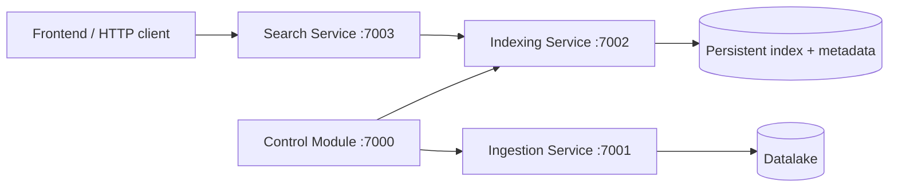

# Stage 2 architecture

The Control Module uses classical HTTP orchestration. A book is first downloaded
and marked ready only after its header and body are atomically published. The
controller then reads the content and calls indexing. Search queries the
published index state through the Indexing Service.

Stage 2 runs all processes on one machine. Each service is a separate process;
Javalin handles concurrent requests with its request threads. The current local
state is protected within each process and persisted atomically. Stage 3 must
replace local paths and process-local protection with shared storage, task
claims, and cross-node coordination.
